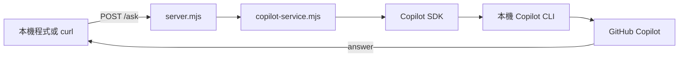
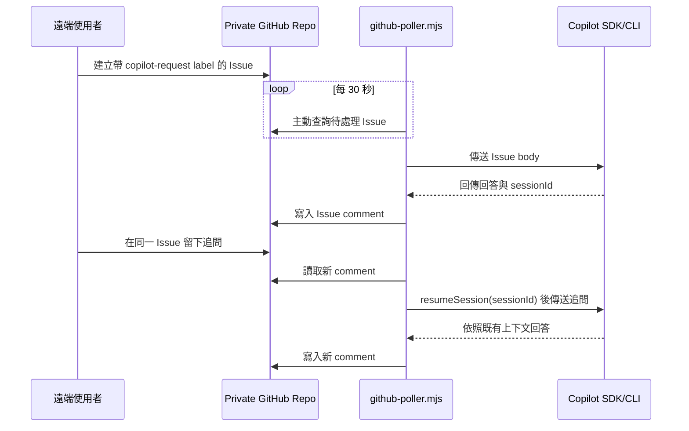

# Copilot Bridge

這個專案使用 `@github/copilot-sdk` 呼叫本機 GitHub Copilot CLI，並提供兩種使用方式：

1. 本機 HTTP API：程式呼叫 `POST /ask` 後取得 Copilot 回答。
2. GitHub Issue Poller：另一台電腦在 private repository 建立 Issue，本機程式主動向 GitHub 取回任務，處理後將回答寫回 Issue comment。

GitHub Poller 採用 outbound pull 模式。本機不需要開放入站 port、安裝 Tailscale、啟用 OpenSSH Server，或建立公開 tunnel。

## 系統架構

### 本機 HTTP 模式



HTTP server 預設只監聽 `127.0.0.1:8787`。除非已有公司核准的網路方案，請勿改成 `0.0.0.0` 或公開到 Internet。

### GitHub Issue Poller 模式



此模式只有本機主動連線到 `api.github.com:443`，GitHub 或遠端電腦不會直接連入本機。

## 專案檔案

| 檔案 | 用途 |
|---|---|
| `copilot-service.mjs` | 啟動 Copilot SDK、建立或恢復 session、傳送 prompt |
| `server.mjs` | 本機 HTTP server，提供 `/health` 和 `/ask` |
| `github-poller.mjs` | 輪詢 GitHub Issues、處理任務、寫回 comment |
| `github-poller-state.json` | 執行時產生，保存 Issue 與 Copilot session 的對應關係 |
| `test-copilot.mjs` | Copilot CLI/SDK smoke test |
| `.env` | 本機秘密與設定，不可提交到 Git |
| `environment.example.txt` | `.env` 的無秘密範本 |

## 必要條件

- Windows 10/11。
- Node.js `^20.19.0` 或 `>=22.12.0`。目前已驗證 Node.js 24。
- GitHub Copilot CLI。
- 有效的 GitHub Copilot 使用權。
- GitHub Poller 模式需要 private repository 與 fine-grained personal access token。

確認版本：

```bash
node --version
npm --version
copilot --version
```

安裝依賴：

```bash
npm install
```

## Copilot CLI 登入

Git Bash 的 home 可能與 Windows home 不同。本機 Git Bash 使用：

```text
C:\SPB_Data
```

因此 Copilot 登入資料位於：

```text
C:\SPB_Data\.copilot
```

登入：

```bash
export COPILOT_HOME="/c/SPB_Data/.copilot"
copilot login
```

`copilot-service.mjs` 會將 Git Bash 路徑 `/c/SPB_Data/.copilot` 轉成 Windows SDK 可使用的 `C:\SPB_Data\.copilot`。

執行 smoke test：

```bash
npm test
```

成功時應看到 Copilot 回答：

```text
copilot bridge works
```

## 環境設定

在專案根目錄建立 `.env`。可參考 `environment.example.txt`：

```dotenv
COPILOT_HOME=C:\SPB_Data\.copilot
COPILOT_MODEL=gpt-5

BRIDGE_API_KEY=replace-with-a-long-random-secret
HOST=127.0.0.1
PORT=8787

GITHUB_TOKEN=YOUR_GITHUB_TOKEN
GITHUB_OWNER=112703028
GITHUB_REPO=copilot-request-queue
GITHUB_ALLOWED_USERS=112703028
POLL_INTERVAL_MS=30000
```

`dotenv` 會在程式啟動時自動載入 `.env`。不需要再逐一執行 `export`。

### 環境變數

| 變數 | 必要 | 預設值 | 說明 |
|---|---:|---|---|
| `COPILOT_HOME` | 建議 | `$HOME/.copilot` | Copilot CLI 的登入與資料目錄 |
| `COPILOT_MODEL` | 否 | `gpt-5` | Copilot session 使用的模型 |
| `BRIDGE_API_KEY` | HTTP 模式必要 | 無 | `/ask` 的 API key |
| `HOST` | 否 | `127.0.0.1` | HTTP server 綁定位置 |
| `PORT` | 否 | `8787` | HTTP server port |
| `GITHUB_TOKEN` | Poller 必要 | 無 | GitHub fine-grained PAT |
| `GITHUB_OWNER` | 否 | `112703028` | Queue repository owner |
| `GITHUB_REPO` | 否 | `copilot-request-queue` | Queue repository 名稱 |
| `GITHUB_ALLOWED_USERS` | 否 | owner | 可送出任務的 GitHub username，逗號分隔 |
| `POLL_INTERVAL_MS` | 否 | `30000` | GitHub 輪詢間隔，單位為毫秒 |

`.env` 已列入 `.gitignore`。不要把 token、API key 或 `.copilot` 內容提交到 Git、貼入 Issue 或傳送到聊天。

## 建立 GitHub Token

前往：

<https://github.com/settings/personal-access-tokens/new>

建議設定：

```text
Token name: copilot-request-poller
Expiration: 30 days，或依公司規範
Resource owner: 112703028
Repository access: Only select repositories
Repository: copilot-request-queue
Repository permissions: Issues - Read and write
```

`Metadata: Read` 通常由 GitHub 自動加入，可能無法手動選取。

將 token 寫入本機 `.env`：

```dotenv
GITHUB_TOKEN=YOUR_GITHUB_TOKEN
```

Token 只會在建立時完整顯示一次。若 token 曾出現在 commit、Issue、console log 或聊天中，應立即在 GitHub 撤銷並重新建立。

## GitHub Repository 設定

目前 queue repository：

```text
112703028/copilot-request-queue
```

Repository 應設定為 private，並建立 label：

```text
copilot-request
```

Poller 只查詢符合以下條件的項目：

- Issue 仍為 open。
- 具有 `copilot-request` label。
- 不是 Pull Request。
- Issue 或 comment 作者存在於 `GITHUB_ALLOWED_USERS`。

## 使用 GitHub Issue Poller

### 1. 啟動 Poller

```bash
npm run poll
```

正常啟動：

```text
Polling 112703028/copilot-request-queue every 30 seconds
```

此 terminal 必須保持執行。電腦睡眠、重開機或程序停止時不會處理任務。

### 2. 建立第一個任務

在 private repository 建立 Issue：

```text
Title: First Copilot test

Body:
Reply exactly: GitHub poller works

Label:
copilot-request
```

等待最多一個 polling interval。Poller 會在 terminal 顯示：

```text
Processing 112703028/copilot-request-queue#1
```

回答會以 Issue comment 寫回，並包含不可見 marker：

```html
<!-- copilot-bridge-response -->
```

Poller 透過 marker 排除自己產生的 comment，避免把回答再次當成 prompt。

### 3. 延續對話記憶

直接在同一個 Issue 留下新 comment，例如：

```text
請再用一個簡單例子解釋。
```

Poller 會取得本機保存的 `sessionId`，執行：

```js
client.resumeSession(sessionId)
```

因此 Copilot 可以延續同一個 Issue 的前文。不同 Issue 會建立不同 Copilot session，彼此不共享上下文。

### 4. 結束任務

不再需要對話時，關閉 Issue或移除 `copilot-request` label。Poller 只處理 open 且仍帶有該 label 的 Issue。

## 記憶如何保存

Poller 將狀態保存在本機 `github-poller-state.json`：

```json
{
  "issues": {
    "1": {
      "sessionId": "copilot-session-id",
      "initialProcessed": true,
      "lastCommentId": 123456789
    }
  }
}
```

欄位用途：

- `sessionId`：恢復 Copilot 對話。
- `initialProcessed`：避免重複處理 Issue body。
- `lastCommentId`：避免重複處理相同追問。

狀態會先寫入 `github-poller-state.tmp`，再 rename 成正式檔案，降低寫入中斷導致 JSON 損壞的風險。兩個狀態檔都已加入 `.gitignore`。

刪除 `github-poller-state.json` 會清除 Poller 的 Issue/session 對應。若 Issue 仍保持 open 且帶 label，下次啟動可能重新處理 Issue body，因此刪除前應先停止 Poller並移除 label 或關閉 Issue。

## 本機 HTTP API

### 啟動

確保 `.env` 包含：

```dotenv
BRIDGE_API_KEY=replace-with-a-long-random-secret
HOST=127.0.0.1
PORT=8787
```

執行：

```bash
npm start
```

正常啟動：

```text
Copilot bridge listening on http://127.0.0.1:8787
```

### 健康檢查

```bash
curl.exe http://127.0.0.1:8787/health
```

回應：

```json
{"ok":true}
```

### 呼叫 Copilot

Git Bash：

```bash
curl.exe -X POST http://127.0.0.1:8787/ask \
  -H "Content-Type: application/json" \
  -H "X-API-Key: your-bridge-api-key" \
  -d "{\"prompt\":\"Reply exactly: bridge works\"}"
```

回應：

```json
{"answer":"bridge works"}
```

HTTP `/ask` 每次都建立新 session，而且不接受 session ID，因此目前不保留跨請求對話記憶。需要記憶時使用 GitHub Issue Poller。

### HTTP Status

| Status | 說明 |
|---:|---|
| `200` | 成功或健康檢查通過 |
| `400` | `prompt` 不是非空字串 |
| `401` | `X-API-Key` 缺少或錯誤 |
| `404` | 路徑或 HTTP method 不存在 |
| `500` | JSON 解析、Copilot 或其他內部錯誤 |

HTTP request body 上限約為 1 MiB。GitHub Poller 的 prompt 上限則是 4,000 個 JavaScript 字元。

## 程式運作細節

### `copilot-service.mjs`

模組載入時會依序：

1. 透過 `dotenv/config` 載入 `.env`。
2. 決定 `COPILOT_HOME`，並轉換 Git Bash 路徑。
3. 建立 `CopilotClient`。
4. 執行 `client.start()`。

`askCopilot(prompt, sessionId)` 的行為：

- 有 `sessionId`：使用 `resumeSession()` 恢復對話。
- 無 `sessionId`：使用 `createSession()` 建立對話。
- 使用 `sendAndWait()` 等待最終 assistant message。
- 回傳 `{ answer, sessionId }`。
- 無論成功或失敗都執行 `session.disconnect()`。

目前 session 設定：

```js
{
  model: process.env.COPILOT_MODEL ?? "gpt-5",
  onPermissionRequest: approveAll,
}
```

`approveAll` 代表 SDK 的工具權限請求會自動批准。這是目前已知的高風險設定，尤其在輸入來自 GitHub Issue 時。此 README 記錄現況，不表示建議把服務公開或允許不受信任使用者送出任務。

### `github-poller.mjs`

每輪 polling：

1. 載入本機狀態。
2. 查詢最多 20 個 open、帶 `copilot-request` label 的 Issue。
3. 依建立時間由舊到新處理。
4. 驗證 Issue/comment 作者是否在 allowlist。
5. 第一次使用 Issue body，之後使用下一個尚未處理的 comment。
6. 呼叫 Copilot。
7. 將回答寫成 GitHub comment。
8. 更新本機 session 與 comment 狀態。

同一輪依序處理 Issue，不會平行呼叫 Copilot。

## 修改程式碼的行為

GitHub Issue Poller 目前只保證將 Copilot 的最終文字回答寫回 Issue comment。它尚未實作：

- 自動 clone 其他 repository。
- 自動建立 Git branch。
- 自動 commit 或 push。
- 自動建立 Pull Request。
- 自動上傳修改後檔案。

由於目前使用 `approveAll`，Copilot 可能依工具能力修改 Poller 程序 working directory 附近的本機檔案。這些變更只存在本機，不會自動回傳到 GitHub。若只希望取得建議或 diff，應在 Issue prompt 明確要求：

```text
不要直接修改檔案。請只在回答中提供 unified diff。
```

正式自動修改程式碼應另行設計受控 workspace、固定 repository allowlist、branch/PR 流程、測試、稽核與人工 review。

## 限制

- Poller 不是即時服務，延遲最長約為一個 polling interval 加上 Copilot 處理時間。
- GitHub API 有 rate limit；不建議把 polling 設為每秒執行。
- 每次只讀取最新 100 個 comments 中下一個待處理 comment。
- 每輪最多查詢 20 個符合條件的 open Issues，尚未實作 pagination。
- GitHub Issues 不是可靠訊息佇列，程序可能在 Copilot 完成但寫回 comment 前中斷。
- 本機狀態依 Issue number 索引，設定固定對應單一 repository。
- 公司電腦睡眠或 Poller 停止時不會處理請求。
- Issue、comment 與回答會保留在 GitHub，必須遵守資料分類與公司政策。
- 目前沒有每小時 10 次的程式限制；該數字只是先前討論的建議護欄，尚未實作。
- 目前沒有 HTTP rate limit、request timeout、JWT、IP allowlist 或多使用者權限分級。
- HTTP 模式沒有跨請求記憶。

## 安全注意事項

- 只使用公司核准的 private repository、GitHub 身分與 Copilot 帳號。
- 不要將公司機密、客戶資料、憑證、token 或受限制原始碼放入 Issue。
- `GITHUB_TOKEN` 只授權單一 queue repository，權限僅給 Issues read/write。
- 定期輪替 token，並設定合理 expiration。
- `GITHUB_ALLOWED_USERS` 只加入必要帳號。
- 不要公開 `8787`、建立 port forwarding 或使用未核准 tunnel。
- 不要把 `HOST` 改成 `0.0.0.0`，除非公司 IT 已核准網路架構。
- 若 token 洩漏，立即撤銷，而不是只從檔案刪除。
- GitHub 帳號 allowlist 只能識別送出者，不能讓惡意 prompt 自動變安全。

## 停止服務

在執行 server 或 Poller 的 terminal 按：

```text
Ctrl+C
```

程式會收到 `SIGINT`，停止 Copilot client。HTTP server 也會停止接受新請求。

## 常見問題

### `BRIDGE_API_KEY is required`

原因：執行 `npm start` 時 `.env` 沒有 `BRIDGE_API_KEY`。

處理：

```dotenv
BRIDGE_API_KEY=replace-with-a-long-random-secret
```

### `GITHUB_TOKEN is required`

原因：執行 `npm run poll` 時 `.env` 沒有 token，或 `.env` 不在專案根目錄。

### GitHub API `401`

Token 無效、過期或被撤銷。建立新 token 並更新 `.env`。

### GitHub API `403`

可能原因：

- Token 權限不足。
- Organization 尚未批准 token。
- API rate limit。
- 公司 GitHub 政策阻擋。

### GitHub API `404`

Private repository 存在時，GitHub 也可能因 token 看不到該 repository 而回傳 404。檢查 owner、repo 與 repository access。

### Issue 沒有被處理

依序確認：

1. Poller terminal 是否仍在執行。
2. Issue 是否為 open。
3. Issue 是否有 `copilot-request` label。
4. 作者 username 是否存在於 `GITHUB_ALLOWED_USERS`。
5. Issue body 是否為 1 到 4,000 字元。
6. 等待時間是否已超過 `POLL_INTERVAL_MS`。
7. Poller terminal 是否顯示 GitHub API 或 Copilot 錯誤。

### `No GitHub OAuth token or Copilot HMAC key provided`

Copilot SDK 沒有讀到 CLI 登入資料。確認：

```dotenv
COPILOT_HOME=C:\SPB_Data\.copilot
```

必要時重新登入：

```bash
export COPILOT_HOME="/c/SPB_Data/.copilot"
copilot login
```

### `EADDRINUSE`

指定 port 已被其他程序使用。停止舊 server 或修改 `.env`：

```dotenv
PORT=8790
```

### `source ~/.bashrc` 回傳失敗

使用 dotenv 後，正常啟動不依賴 `.bashrc` 內的專案設定。只要 Node.js 已在 `PATH`，可以直接執行 `npm start` 或 `npm run poll`。

## npm 指令

```bash
# 驗證 Copilot SDK/CLI
npm test

# 執行單元測試
npm run test:unit

# 啟動本機 HTTP API
npm start

# 啟動 GitHub Issue Poller
npm run poll

# 啟動家裡端 MCP relay(stdio)
npm run mcp
```

## Patch Relay(家裡 MCP server)

`mcp-relay.mjs` 是一個跑在**家裡**的 stdio MCP server,讓家裡的 MCP client
(Claude Code / Cursor / Claude Desktop)把公司電腦的 Copilot 當工具用:派它對
一個 **public** GitHub repo 做修改,取回 unified diff patch。

### 為什麼是「回 patch」而不是「直接開 PR」

公司帳號是 Enterprise Managed User (EMU),**不能寫入企業外的 repo**
(push / fork / 開 PR 到個人 repo 皆被擋)。但 EMU **能讀取 public repo**。
因此 Copilot 只做「clone public repo → 改 → 產 diff」(全是讀取與本機操作,
不碰 EMU 寫入牆),把 patch 透過 GitHub Issue 中轉回家裡。實際 push / 開 PR
由**你在家裡用個人身分**完成。這條路不繞任何公司政策。

### 前提

- 公司電腦 poller 在跑、Copilot 已登入。
- 目標專案是 **public** repo(EMU 讀不到 private)。
- 家裡 `.env` 的 `GITHUB_TOKEN` 是個人 PAT,對 queue repo 有 Issues 讀寫。

### 啟動

```bash
npm run mcp
```

在 MCP client 設定此 server 以 stdio 連線,工作目錄為本專案。

### Tools

| Tool | 用途 |
|---|---|
| `copilot_patch({ repo, task, timeoutSeconds? })` | 派 Copilot 對 public repo 做修改,回傳 `{ patch, issueNumber }`;逾時回 `{ status: "pending", issueNumber }` |
| `copilot_patch_followup({ issueNumber, task, timeoutSeconds? })` | 對同一個 Issue 追問,延續 Copilot 上下文,回傳**完整的新 patch**(含先前修改 + 這次調整) |
| `check_patch({ issueNumber })` | 逾時後補查該 Issue 是否已有 patch |

拿到 patch 後,由家裡 Claude **先展示給你、確認後才 `git apply`**,不自動套用。

### 追問(延續對話)

初次 `copilot_patch` 回傳 `issueNumber` 後,用 `copilot_patch_followup` 帶同一個
`issueNumber` 追問。因為是**同一個 Issue**,poller 會用 `resumeSession` 讓 Copilot
延續前一輪的上下文,並回傳一份**完整的新 patch**(包含之前的修改 + 這次的調整),
家裡直接對乾淨專案套用即可。不同 Issue 之間不共享記憶。

詳見 [`docs/patch-relay-smoke.md`](docs/patch-relay-smoke.md) 的手動驗證步驟。

## 目前建議使用方式

1. 保持 repository private。
2. 保持 HTTP `HOST=127.0.0.1`。
3. 使用 GitHub Issue Poller完成遠端文字問答。
4. 同一 Issue 用於同一段對話，透過 comments 延續記憶。
5. 完成後關閉 Issue或移除 label。
6. 不要把目前版本當作公開 API 或無人監督的程式碼修改服務。